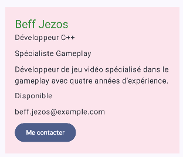

Duncan Hamelin ESGI – M1 IW (2026-2027)

1. Profil développeur

2. J'ai développé une mini-application avec jetpack compose qui affiche le profil d'un développeur. On
peut y retrouver le nom, le métier, la spécialité, une description, le mail, la disponibilité et 
un bouton "me contacter" qui écrit une phrase dans le terminal. J'ai aussi fait deux previews pour
un développeur jeu vidéo et un golang.

3. Notions :
-Composables 
-Paramètres
-Padding interne et externe
-Modifier
-Callback onClick
-Previews

4.1.
ProfilDevelopeurEcran, Titre, Specialite, Disponibilite et BoutonContact.

4.2.
ProfilDevelopeurEcran.

4.3.
Dans ProfilDevelopeurEcran sur la surface.

4.4.
Dans la colonne à l'intérieur de la surface avec padding(20.dp).

4.5.
BoutonContact reçoit un paramètre onClick pour « Bonjour, je suis {nom} » dans le terminal.

4.6.
Le bouton est un élément interactif avec label, son texte est descriptif et sa couleur contrastée.

4.7.
Car ils reçoivent des paramètres dynamiquement, le parent change le placement avec Modifier, les previews affichent deux profils différents avec les mêmes composants.

5.

